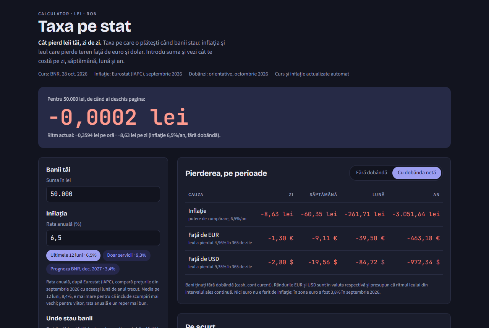

# Taxa pe stat

[](https://github.com/RomulusMirauta/taxa-pe-stat/actions/workflows/publish.yml)
[](LICENSE)

**Cât pierd leii tăi, zi de zi.** Taxa pe care o plătești când banii stau: inflația și leul care pierde teren față de euro și dolar, pe zi, săptămână, lună și an.

**→ [romulusmirauta.github.io/taxa-pe-stat](https://romulusmirauta.github.io/taxa-pe-stat/)**



## Ce face

- Calculează pierderea pe **zi, săptămână, lună și an**, din trei cauze, fiecare pe rândul ei:
  - inflația (puterea de cumpărare);
  - leul față de euro;
  - leul față de dolar.
- **Unde stau banii schimbă rezultatul:** cont curent, depozit sau titluri de stat, cu impozitul pe dobândă și comisioanele.
- **Contor live:** cât ai pierdut (sau câștigat) de când ai deschis pagina.
- **Pe scurt:** cât s-a pierdut deja în euro și dolari în ultimul an și dobânda minimă cu care ții pasul cu inflația.
- **Grafic pe 10 ani** al puterii de cumpărare.
- **Datele se actualizează singure** în zilele lucrătoare: cursul BNR și inflația de la Eurostat.

Nu este consultanță financiară. Ce introduci rămâne în browserul tău: pagina nu face cereri către alte site-uri, nu le trimite adresa ei și nu are analytics.

## Cum funcționează

- **Pagina** e un singur fișier, `app.html`, fără framework și fără dependențe. Calculele stau separat, în `<script id="calc">`, ca să poată fi testate.
- **Datele:** în zilele lucrătoare, după ce BNR publică cursul, workflow-ul `publish.yml` din GitHub Actions:
  - rulează `scripts/update-data.mjs`, care ia cursul BNR (rezervă: BCE) și inflația IAPC de la Eurostat, le verifică și scrie `data/rates.json`, dacă s-a schimbat ceva;
  - rulează testele pe datele noi, apoi face commit ca `github-actions[bot]`;
  - republică site-ul.
- **Dacă o sursă cade,** rămân datele anterioare și apare un avertisment. După publicare, o verificare separată eșuează, iar GitHub trimite email, dacă datele s-au oprit: cursul are peste 7 zile sau vine de la BCE, ori inflația e prea veche.
- **Dobânzile** se actualizează de mână. Depozitul folosește media BNR a dobânzilor la depozitele noi la termen în lei ale populației, cu scadența de 6–12 luni (Buletinul lunar BNR, tabelul 10.1.2). BNR o publică la circa două luni după luna respectivă, așa că pagina arată ultima lună publicată și o marchează ca veche abia după circa 4 luni de la sfârșitul ei. Dobânda Tezaur e cea a emisiunii din luna respectivă.
- **Pagina citește `data/rates.json`** de pe același domeniu și îl validează. Fără fișier, folosește valorile din `app.html`. Când schimbi o dată, cursul acelei zile vine din istoricul BNR din fișier.

Formulele, sursele și deciziile sunt în [`DESIGN.md`](DESIGN.md). Problemele, cele reparate și cele încă deschise, sunt în [`FINDINGS.md`](FINDINGS.md). Documentația pentru dezvoltare e în engleză.

## Rulare locală

Ai nevoie de Node.js 22 sau mai nou. Nu există dependențe de instalat. Testul în browser (`e2e.test.mjs`) folosește Google Chrome, dacă e instalat; altfel e sărit.

```
npm run dev        # http://localhost:5173, deschide browserul, se reîncarcă la salvare
npm test           # toate testele
npm run build      # → dist/: pagina completă, fonturile, datele, imaginea de previzualizare
node scripts/update-data.mjs   # datele de azi (are nevoie de internet)
```

Pe Windows, `start.cmd` pornește serverul și deschide browserul.

## Teste

Testele folosesc `node:test`, fără dependențe, și stau toate în `tests/`:

| Fișier | Ce verifică |
|---|---|
| `calc.test.mjs` | calculele: inflație, curs, dobândă, comisioane, numere scrise ca în română, exemplul din DESIGN §6 |
| `data.test.mjs` | datele automate: BNR, BCE, Eurostat, cu rețea simulată, inclusiv când sursele cad |
| `fresh.test.mjs` | verificarea de după publicare: când datele s-au oprit |
| `page.test.mjs` | regulile paginii, scripturile ei, legăturile cod ↔ pagină, temele light și dark |
| `e2e.test.mjs` | pagina reală, în Chrome headless: fără erori, câmpuri, date, teme, telefon |
| `build.test.mjs` | build-ul: CSP, căi relative, fonturi locale și licențele lor, pagina 404, adresa publică |
| `serve.test.mjs` | serverul local, inclusiv protecția la `../` |
| `workflow.test.mjs` | workflow-urile GitHub: permisiunile, ce commit se publică, ordinea pașilor |

Rulează în GitHub Actions înainte de fiecare publicare și la fiecare pull request.

## Publicare

GitHub Pages, prin `.github/workflows/publish.yml`:
- **push pe `main`** → teste → build → publicare;
- **zilele lucrătoare** → date noi → teste → commit → teste → build → publicare;
- **după publicare** → verificarea că datele nu s-au oprit.

Configurare, o singură dată: Settings → Pages → Source: **GitHub Actions**.

## Istoric

Fiecare pas e un commit, iar versiunile au tag-uri. Pe scurt, în [`CHANGELOG.md`](CHANGELOG.md):

| Versiune | Ce aduce |
|---|---|
| **v0.1.0** | *Ceasul leului*, prima versiune |
| **v0.2.0** | review-ul 1: 30 de probleme găsite și reparate, build, teste |
| **v0.3.0** | *Taxa pe stat*: nume nou, date automate, publicare pe GitHub Pages |
| **v0.3.1** | datele automate merg cu adevărat; cursul urmează datele alese; 43 de probleme găsite de două review-uri și o rundă de testare, reparate; test în browser; documentația în engleză |
| **v0.3.2** | tabelul de pierderi se vede întreg pe telefon; contorul încetinește imediat când pornești „mișcare redusă” |
| **v0.3.3** | pe telefon: tabelul cu o perioadă pe rând, graficul la mărimea lui, butoane și câmpuri ușor de atins |
| **v0.3.4** | dobânda la depozit: media oficială BNR pe 6–12 luni, cu întârzierea ei de publicare explicată |

Cum lucrăm (cu Claude, copia locală): [`docs/DEVELOPMENT.md`](docs/DEVELOPMENT.md). Idei pentru mai târziu: [`docs/IDEAS.md`](docs/IDEAS.md).

## In English

*Taxa pe stat* ("the tax for standing still") shows how much money kept in Romanian lei loses every day, week, month and year:
- to inflation;
- to the leu's slide against the euro and the US dollar;
- after deposit interest, tax and bank fees.

Exchange rates (BNR, with ECB as fallback) and inflation (Eurostat HICP) are refreshed automatically on weekdays by GitHub Actions and committed to the repo. The page is a single dependency-free HTML file, and the project has 230+ tests built on `node:test`, including an end-to-end test that drives the built page in headless Chrome. Its history, starting as *Ceasul leului*, is kept commit by commit, with a findings log in [`FINDINGS.md`](FINDINGS.md). The developer documentation ([`DESIGN.md`](DESIGN.md), [`FINDINGS.md`](FINDINGS.md), [`CHANGELOG.md`](CHANGELOG.md), [`docs/`](docs/)) is in English.

## Licență

[MIT](LICENSE). Fonturile sunt sub licența SIL OFL 1.1 (`fonts/`).
